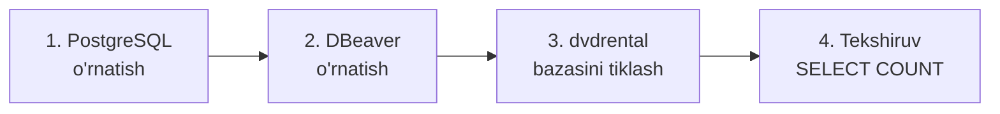
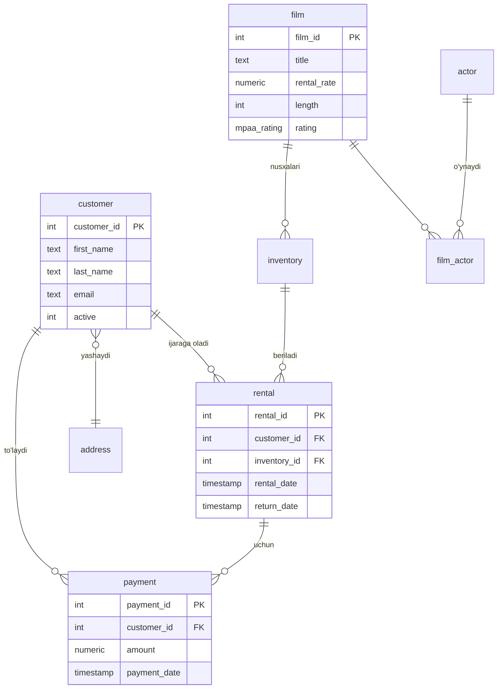

# 🧰 Muhitni sozlash

Taxminiy vaqt: **1 soat**. Natijada kompyuteringizda PostgreSQL, SQL yozish uchun qulay dastur va mashq qiladigan namuna baza bo'ladi.



## 1. PostgreSQL o'rnatish

1. [postgresql.org/download](https://www.postgresql.org/download/) saytidan operatsion tizimingizni tanlang. Windows uchun **EDB installer** ni yuklang.
2. O'rnatishda barcha komponentlarni qoldiring (PostgreSQL Server, pgAdmin, Command Line Tools).
3. `postgres` foydalanuvchisi uchun **parol** o'ylab toping va yozib qo'ying. Uni keyin ko'p so'raydi.
4. Port: `5432` (standart, o'zgartirmang).

> [!WARNING]
> Parolni unutsangiz, qayta o'rnatishga to'g'ri keladi. Uni hoziroq xavfsiz joyga yozing.

## 2. DBeaver o'rnatish

[DBeaver Community](https://dbeaver.io/download/) bepul va SQL yozish uchun eng qulay dasturlardan biri. pgAdmin ham ishlaydi, lekin DBeaver keyinchalik boshqa bazalar (MySQL, Snowflake, BigQuery) bilan ham ishlay oladi.

Ulanish: **New Database Connection → PostgreSQL** → Host `localhost`, Port `5432`, User `postgres`, parolingiz.

## 3. Namuna baza: `dvdrental`

Bu DVD ijara do'konining bazasi: filmlar, aktyorlar, mijozlar, ijaralar, to'lovlar. 15 ta jadval, real hayotga yaqin.

1. [Bu sahifadan](https://www.postgresqltutorial.com/postgresql-getting-started/postgresql-sample-database/) `dvdrental.zip` ni yuklang va ochib, `dvdrental.tar` ni oling.
2. Yangi baza yarating:
   ```sql
   CREATE DATABASE dvdrental;
   ```
3. Terminalda (Windows'da `cmd`) tiklang:
   ```bash
   pg_restore -U postgres -d dvdrental dvdrental.tar
   ```
   Yoki pgAdmin'da: `dvdrental` bazasi → o'ng tugma → **Restore** → faylni tanlang.

Batafsil qo'llanma: [Load PostgreSQL Sample Database](https://www.postgresqltutorial.com/postgresql-getting-started/load-postgresql-sample-database/).

## 4. Tekshiruv ✅

DBeaver'da `dvdrental` bazasiga ulanib, ishga tushiring:

```sql
SELECT COUNT(*) FROM film;
```

Natija **1000** bo'lsa, hammasi tayyor. 🎉

## 🗺️ Bazaning asosiy jadvallari



Birinchi 3 darsda asosan `film`, `customer`, `payment` va `address` jadvallari bilan ishlaymiz. Qolganlari 4-haftada JOIN'lar bilan kerak bo'ladi.

## 🆘 O'rnatib bo'lmasa

[DB Fiddle](https://www.db-fiddle.com/) yoki [OneCompiler PostgreSQL](https://onecompiler.com/postgresql) brauzerda ishlaydi. Ularga katta baza yuklab bo'lmaydi, shuning uchun bu faqat vaqtinchalik yechim.
