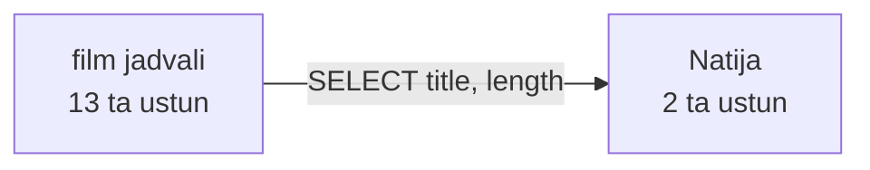
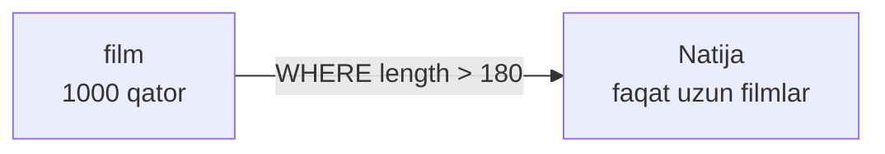
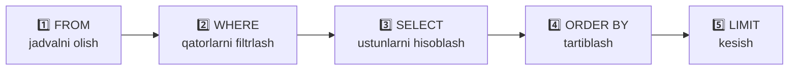

# 01 — SELECT, WHERE, ORDER BY, LIMIT va NULL

> ⏱️ Vaqt: 3–4 soat · 📊 Daraja: boshlang'ich · 🗃️ Baza: `dvdrental`

## 🎯 Bu darsdan keyin siz

- [ ] jadvaldan kerakli ustunlarni tanlaysiz va ularga nom berasiz;
- [ ] qatorlarni har xil shartlar bilan filtrlaysiz;
- [ ] natijani tartiblab, kerakli sonini olasiz;
- [ ] `NULL` bilan to'g'ri ishlaysiz (bu ko'p dasturchilar yiqiladigan joy);
- [ ] so'rov qaysi tartibda bajarilishini tushunasiz.


## 📖 Bu darsdagi atamalar

Darsni boshlashdan oldin shu so'zlar bilan tanishib oling. To'liq ro'yxat: [Atamalar lug'ati](../atamalar.md).

| Atama | Ma'nosi | Misol |
|---|---|---|
| **Ma'lumotlar bazasi** (database) | Ma'lumotlar tartibli saqlanadigan joy, ichida jadvallar bor | `dvdrental` bazasi |
| **Jadval** (table) | Bir turdagi narsalar ro'yxati: qatorlar va ustunlar | `film`, `customer` |
| **Qator** (row) | Jadvaldagi bitta narsa: bitta film, bitta mijoz | "Academy Dinosaur" filmi haqidagi barcha ma'lumot |
| **Ustun** (column) | Har qatordagi bitta xususiyat | `title` (nomi), `length` (davomiyligi) |
| **SQL** | Bazaga savol berish tili | `SELECT title FROM film;` |
| **So'rov** (query) | Bazaga yuborilgan bitta SQL buyruq | Yuqoridagi qator bitta so'rov |
| **Primary key** | Har qatorni yagona aniqlovchi ustun, takrorlanmaydi | `film_id` — har filmning o'z raqami |
| **Foreign key** | Boshqa jadvaldagi qatorga ishora qiluvchi ustun | `payment.customer_id` → qaysi mijoz to'lagani |
| **Shart** (condition) | Rost yoki yolg'on bo'ladigan ifoda | `length > 120` |
| **Filtr** | Shartga mos kelmagan qatorlarni chiqarib tashlash | `WHERE rating = 'PG'` |
| **Alias** | Ustunga vaqtinchalik yangi nom berish | `length AS daqiqa` |
| **NULL** | "Qiymat yo'q / noma'lum". 0 ham, bo'sh matn ham emas | Hali qaytarilmagan DVD'ning qaytarilish sanasi |
| **Izoh** (comment) | `--` dan keyingi yozuv, baza uni bajarmaydi | `-- bu izoh` |

### SQL so'rovining tuzilishi

Birinchi so'rovni bo'laklarga ajratib ko'ramiz:

```sql
SELECT title, length      -- 1. Qaysi USTUNLAR kerak?
FROM film                 -- 2. Qaysi JADVALDAN?
WHERE length > 120        -- 3. Qaysi QATORLAR qolsin? (shart)
ORDER BY length DESC      -- 4. Qanday TARTIBDA?
LIMIT 5;                  -- 5. NECHTASI?
```

O'zbekchaga tarjima qilsak: *"`film` jadvalidan davomiyligi 120 daqiqadan uzun filmlarning nomi va davomiyligini, eng uzunidan boshlab, 5 tasini ko'rsat."*

> [!TIP]
> Har bir SQL so'rovni shunday oddiy gapga "tarjima" qilib o'qishni odat qiling. Gapga aylantira olsangiz, demak tushungansiz.

> [!NOTE]
> `;` (nuqtali vergul) so'rov tugaganini bildiradi. SQL kalit so'zlarini (`SELECT`, `FROM`) katta harf bilan yozish shart emas, lekin odat shunday, chunki kod o'qishga oson bo'ladi.

---

## 1. Relyatsion baza nima? 🧱

Bazani **Excel fayli** deb tasavvur qiling:

| Excel | Baza |
|---|---|
| Fayl | **Baza** (database) — `dvdrental` |
| Varaq (sheet) | **Jadval** (table) — `film`, `customer` |
| Ustun sarlavhasi | **Ustun** (column) — `title`, `rental_rate` |
| Har bir qator | **Qator** (row) — bitta film, bitta mijoz |

Farqi shundaki, bazada:

- har ustunning **qat'iy turi** bor (`integer`, `text`, `numeric`, `timestamp`), unga noto'g'ri tur yozib bo'lmaydi;
- har qatorni yagona aniqlovchi **primary key** bor (masalan, `film_id`);
- jadvallar bir-biriga **foreign key** orqali bog'lanadi (`payment.customer_id` → `customer.customer_id`);
- millionlab qator bilan ham tez ishlaydi.

**SQL** (Structured Query Language) bu bazaga savol berish tili. Siz *nima* kerakligini aytasiz, *qanday* topishni baza o'zi hal qiladi.

---

## 2. SELECT: ustunlarni tanlash 🔦



```sql
-- Barcha ustunlar (faqat jadval bilan tanishish uchun!)
SELECT * FROM film LIMIT 5;

-- Faqat kerakli ustunlar
SELECT title, rental_rate, length
FROM film;
```

### Alias (`AS`) va hisoblangan ustunlar

```sql
SELECT title                    AS nomi,
       length                   AS daqiqa,
       ROUND(length / 60.0, 1)  AS soat,
       rental_rate * 2          AS ikki_kunlik_narx
FROM film;
```

> [!IMPORTANT]
> **Nega `SELECT *` yomon odat?**
>
> 1. Keraksiz ma'lumot o'qiladi va tarmoq orqali uzatiladi.
> 2. Jadvalga yangi ustun qo'shilsa, kodingiz kutilmaganda o'zgaradi yoki buziladi.
> 3. BigQuery, Snowflake kabi cloud warehouse'larda **o'qilgan ustunlar uchun pul to'laysiz**. `SELECT *` sizga to'g'ridan-to'g'ri pul yo'qotish.

> [!TIP]
> `60` emas, `60.0` ga bo'ldik. PostgreSQL'da **butun / butun = butun**: `125 / 60` natijasi `2`, `125 / 60.0` esa `2.083…`. Bu tuzoq 2-darsda yana uchraydi.

---

## 3. WHERE: qatorlarni filtrlash 🧹



`SELECT` **ustunlarni** tanlaydi (vertikal kesish), `WHERE` esa **qatorlarni** tanlaydi (gorizontal kesish).

### Taqqoslash operatorlari

| Operator | Ma'nosi | Misol |
|:---:|---|---|
| `=` | teng | `rating = 'PG'` |
| `<>` yoki `!=` | teng emas | `rating <> 'R'` |
| `>` `<` `>=` `<=` | katta / kichik | `length >= 120` |
| `BETWEEN a AND b` | oraliqda (**chegaralar kiradi**) | `length BETWEEN 60 AND 90` |
| `IN (...)` | ro'yxatdan biri | `rating IN ('G', 'PG')` |
| `LIKE` | matn shabloni | `title LIKE 'A%'` |
| `ILIKE` | katta-kichik harfsiz `LIKE` (PostgreSQL) | `title ILIKE '%love%'` |
| `IS NULL` | qiymati yo'q | `return_date IS NULL` |

```sql
-- Narxi 4.99 va reytingi PG-13 bo'lgan filmlar
SELECT title, rental_rate, rating
FROM film
WHERE rental_rate = 4.99
  AND rating = 'PG-13';

-- 1 soatdan 1.5 soatgacha bo'lgan filmlar
SELECT title, length
FROM film
WHERE length BETWEEN 60 AND 90;

-- Bolalar uchun filmlar
SELECT title, rating
FROM film
WHERE rating IN ('G', 'PG');
```

> [!NOTE]
> Matn **bitta qo'shtirnoq** ichida yoziladi: `'PG'`. Ikki qo'shtirnoq (`"title"`) esa ustun yoki jadval **nomi** uchun ishlatiladi. Bu PostgreSQL'da ko'p uchraydigan chalkashlik.

### LIKE shablonlari 🔍

| Belgi | Ma'nosi | Misol | Mos keladi |
|:---:|---|---|---|
| `%` | istalgan sondagi belgi (0 ham) | `'A%'` | **A**cademy Dinosaur, **A**ce Goldfinger |
| `_` | aynan bitta belgi | `'_a%'` | ikkinchi harfi `a` bo'lgan nomlar |

```sql
SELECT title FROM film WHERE title LIKE 'A%';           -- A bilan boshlanadi
SELECT title FROM film WHERE title LIKE '%Man';         -- Man bilan tugaydi
SELECT first_name FROM customer WHERE first_name ILIKE '%ann%';  -- ichida "ann" bor
```

### AND, OR, NOT va qavslar ⚠️

`AND` har doim `OR` dan **oldin** bajariladi (xuddi matematikada `×` `+` dan oldin bo'lgani kabi).

```sql
-- ❌ Bu "G filmlar YOKI (120 daqiqadan uzun PG filmlar)" degani
WHERE rating = 'G' OR rating = 'PG' AND length > 120

-- ✅ "120 daqiqadan uzun G yoki PG filmlar"
WHERE (rating = 'G' OR rating = 'PG') AND length > 120

-- ✅ Eng toza yo'l
WHERE rating IN ('G', 'PG') AND length > 120
```

> [!TIP]
> **Esda tuting:** `AND` va `OR` aralashsa, **doim qavs qo'ying**. Bu sizni ham, kodingizni o'qiydigan odamni ham xatodan saqlaydi.

---

## 4. ORDER BY va LIMIT: tartiblash va kesish 🏆

```sql
-- Eng uzun 10 ta film; uzunligi teng bo'lsa, nomi bo'yicha
SELECT title, length
FROM film
ORDER BY length DESC, title ASC
LIMIT 10;

-- 11-dan 20-gacha (sahifalash)
SELECT title, length
FROM film
ORDER BY length DESC, title
LIMIT 10 OFFSET 10;
```

- `ASC` — o'sish tartibi (standart, yozmasa ham bo'ladi): 1 → 9, A → Z
- `DESC` — kamayish tartibi: 9 → 1, Z → A

> [!WARNING]
> **`ORDER BY` siz tartib kafolatlanmaydi!** Bugun so'rov natijasi chiroyli tartibda chiqishi mumkin, lekin baza katta bo'lganda yoki parallel o'qiganda tartib o'zgaradi. Tartib kerakmi, `ORDER BY` yozing. Bu data engineeringda dublikat va yo'qolgan qatorlarning klassik sababi.

---

## 5. NULL: "noma'lum" qiymat 👻

`NULL` bu **0 emas**, **bo'sh matn `''` emas**. U *"qiymat noma'lum yoki yo'q"* degani.

Masalan, `rental.return_date` ustunida `NULL` bo'lsa, demak DVD **hali qaytarilmagan**.

### NULL'ning oltin qoidasi

> **NULL bilan har qanday taqqoslash natijasi NULL bo'ladi** va `WHERE` faqat `TRUE` bo'lgan qatorlarni qoldiradi.

| Ifoda | Natija |
|---|:---:|
| `5 = 5` | `TRUE` |
| `5 = NULL` | `NULL` 🤷 |
| `NULL = NULL` | `NULL` 🤷 |
| `NULL <> 'R'` | `NULL` 🤷 |
| `NULL IS NULL` | `TRUE` ✅ |
| `5 + NULL` | `NULL` |

```sql
-- ❌ Hech narsa qaytarmaydi (NULL = NULL → NULL)
SELECT * FROM rental WHERE return_date = NULL;

-- ✅ Hali qaytarilmagan ijaralar
SELECT rental_id, rental_date
FROM rental
WHERE return_date IS NULL;

-- ✅ Qaytarilganlar
SELECT COUNT(*) FROM rental WHERE return_date IS NOT NULL;
```

### COALESCE: NULL o'rniga standart qiymat

`COALESCE(a, b, c)` — birinchi `NULL` bo'lmagan qiymatni qaytaradi.

```sql
SELECT address,
       COALESCE(address2, '(yo''q)') AS address2
FROM address;
```

> [!NOTE]
> Matn ichida `'` belgisini yozish uchun uni ikki marta yozing: `'yo''q'` → `yo'q`. O'zbek tilida bu tez-tez kerak bo'ladi!

> [!CAUTION]
> **Data engineer tuzog'i:** `WHERE rating <> 'R'` so'rovi `rating` `NULL` bo'lgan qatorlarni **qaytarmaydi**. Pipeline'da "qatorlar yo'qolib qoldi" degan muammolarning katta qismi shundan. To'g'ri yozilishi:
>
> ```sql
> WHERE rating <> 'R' OR rating IS NULL
> -- yoki PostgreSQL'da:
> WHERE rating IS DISTINCT FROM 'R'
> ```

---

## 6. So'rov qanday tartibda bajariladi? 🔄

Biz **yozish** tartibi bilan **bajarilish** tartibi bir xil emas. Bu SQL'dagi eng muhim tushunchalardan biri.



Shundan ikki muhim xulosa:

```sql
-- ❌ Xato: WHERE bajarilganda "daqiqa" degan alias hali yo'q
SELECT title, length AS daqiqa FROM film WHERE daqiqa > 100;

-- ✅ ORDER BY esa SELECT'dan keyin, alias allaqachon bor
SELECT title, length AS daqiqa FROM film ORDER BY daqiqa DESC;
```

> 3-darsda bu zanjirga `GROUP BY` va `HAVING` qo'shiladi.

---

## 🧠 Esda qolarli xulosa

| # | Qoida |
|:---:|---|
| 1 | `SELECT` ustunlarni, `WHERE` qatorlarni tanlaydi |
| 2 | `SELECT *` faqat tanishish uchun, ishda ustunlarni nomlab yozing |
| 3 | Matn `'bitta qo'shtirnoq'`da, nomlar `"ikki qo'shtirnoq"`da |
| 4 | `AND` + `OR` = doim qavs |
| 5 | `ORDER BY` siz tartib yo'q |
| 6 | `NULL` bilan faqat `IS NULL` / `IS NOT NULL` |
| 7 | Bajarilish tartibi: **F**ROM → **W**HERE → **S**ELECT → **O**RDER BY → **L**IMIT |

> 💡 **Eslab qolish uchun:** baza avval **qayerdan** (FROM), keyin **qaysi qatorlar** (WHERE), keyin **qaysi ustunlar** (SELECT), keyin **qanday tartibda** (ORDER BY) va oxirida **nechta** (LIMIT) deb so'raydi. Oshpaz kabi: avval omborga boradi, kerakli mahsulotni tanlaydi, to'g'raydi, tartib bilan suzadi, porsiyani beradi.

---

## ✍️ Endi navbat sizda

1. [`queries.sql`](queries.sql) faylidagi barcha so'rovlarni bazangizda ishga tushiring.
2. [`mashqlar.md`](mashqlar.md) dagi 12 ta mashqni yeching.
3. Qo'shimcha: [SQLBolt](https://sqlbolt.com/) 1–4-darslar.

**Keyingi dars:** [02 — Funksiyalar va CASE WHEN](../02-funksiyalar-case/README.md) ➡️
