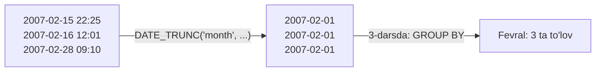
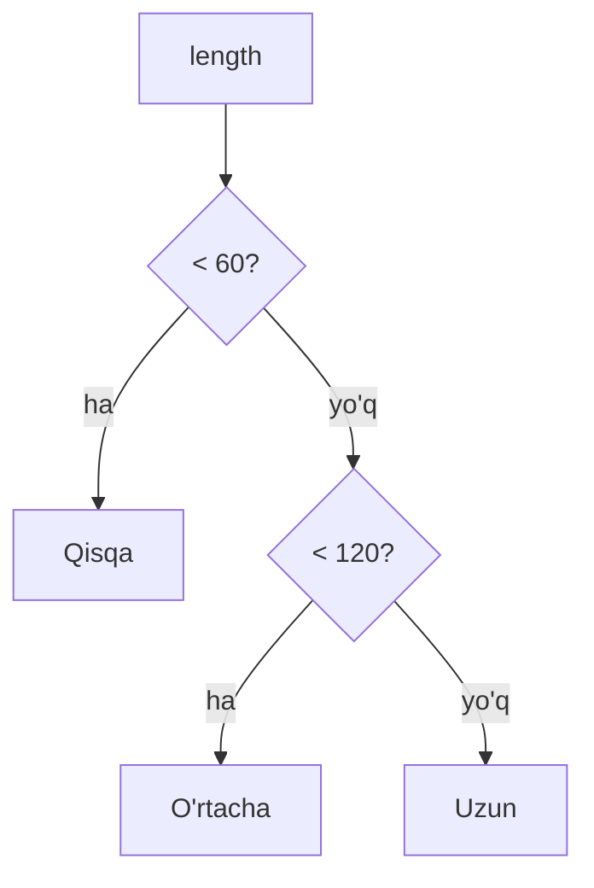

# 02 — Funksiyalar, CASE WHEN va DISTINCT

> ⏱️ Vaqt: 4–5 soat · 📊 Daraja: boshlang'ich · 🗃️ Baza: `dvdrental`

## 🎯 Bu darsdan keyin siz

- [ ] matnni tozalaysiz, kesasiz va birlashtirasiz;
- [ ] sonlar bilan to'g'ri hisoblaysiz (butun bo'lish tuzog'isiz);
- [ ] sanalar bilan ishlaysiz: yil, oy, farq, oy boshiga yaxlitlash;
- [ ] ma'lumot turini o'zgartirasiz (`CAST`, `::`);
- [ ] `CASE WHEN` bilan qatorlarni toifalarga ajratasiz;
- [ ] `DISTINCT` bilan takrorlanmas qiymatlarni olasiz.

> [!NOTE]
> **Nega bu data engineer uchun muhim?** Real ma'lumot "iflos" keladi: ortiqcha bo'shliqlar, har xil yozilgan ismlar, matn ko'rinishidagi sanalar. Pipeline'ning **staging** qatlamida aynan shu funksiyalar bilan ma'lumot tozalanadi.


## 📖 Bu darsdagi atamalar

To'liq ro'yxat: [Atamalar lug'ati](../atamalar.md).

| Atama | Ma'nosi | Misol |
|---|---|---|
| **Funksiya** (function) | Qiymat olib, o'zgartirib qaytaradigan tayyor buyruq | `UPPER('ali')` → `ALI` |
| **Argument** | Funksiyaga qavs ichida beriladigan qiymat | `ROUND(4.567, 2)` da `4.567` va `2` |
| **Ma'lumot turi** (data type) | Ustunda qanday qiymat turishi: son, matn, sana | `int`, `text`, `date` |
| **`int`** | Butun son | `42` |
| **`numeric`** | Aniq kasr son, pul uchun | `4.99` |
| **`float`** | Taxminiy kasr son, pulga yaramaydi | `0.1 + 0.2 = 0.30000000000000004` |
| **`text`** | Matn, bitta qo'shtirnoqda yoziladi | `'Toshkent'` |
| **`date` / `timestamp`** | Sana / sana va vaqt | `2026-11-13` / `2026-11-13 12:41` |
| **Interval** | Vaqt oralig'i | `INTERVAL '7 days'` |
| **Tur o'zgartirish** (cast) | Qiymatni boshqa turga o'tkazish | `'42'::int` |
| **Butun bo'lish** | Butun / butun = butun, kasr tashlanadi | `7 / 2 = 3` |
| **Qoldiq** (`%`) | Bo'lishdan qolgan qism | `7 % 2 = 1` |
| **`CASE WHEN`** | "Agar … bo'lsa … aks holda …" | uzunlikka qarab "Qisqa / Uzun" |
| **`DISTINCT`** | Takrorlanganlarni bittaga qisqartirish | qanday reytinglar borligi |
| **Staging** | Pipeline'da xom ma'lumot tozalanadigan qatlam | ism va emaillarni tozalash shu yerda |

---

## 1. Matn funksiyalari 🔤

| Funksiya | Nima qiladi | Misol | Natija |
|---|---|---|---|
| `UPPER(s)` / `LOWER(s)` | katta / kichik harf | `LOWER('SQL')` | `sql` |
| `INITCAP(s)` | har so'z bosh harfi katta | `INITCAP('jared ely')` | `Jared Ely` |
| `LENGTH(s)` | belgilar soni | `LENGTH('Toshkent')` | `8` |
| `TRIM(s)` | boshidagi va oxiridagi bo'shliqlarni olib tashlaydi | `TRIM('  ali  ')` | `ali` |
| `s1 \|\| s2` yoki `CONCAT(s1, s2)` | birlashtirish | `'Ali' \|\| ' ' \|\| 'Valiyev'` | `Ali Valiyev` |
| `SUBSTRING(s, start, len)` | kesib olish | `SUBSTRING('Samarqand', 1, 3)` | `Sam` |
| `LEFT(s, n)` / `RIGHT(s, n)` | chapdan / o'ngdan n ta | `RIGHT('2026-11', 2)` | `11` |
| `REPLACE(s, a, b)` | almashtirish | `REPLACE('a-b-c', '-', '/')` | `a/b/c` |
| `SPLIT_PART(s, sep, n)` | ajratib n-qismini olish | `SPLIT_PART('ali@mail.uz', '@', 2)` | `mail.uz` |
| `POSITION(a IN s)` | qayerda turibdi | `POSITION('@' IN 'ali@mail.uz')` | `4` |

```sql
-- To'liq ism va email domeni
SELECT first_name || ' ' || last_name       AS toliq_ism,
       LOWER(email)                         AS email,
       SPLIT_PART(email, '@', 2)            AS domen,
       LENGTH(first_name)                   AS ism_uzunligi
FROM customer;
```

> [!WARNING]
> `||` bilan birlashtirishda bitta qism `NULL` bo'lsa, **butun natija `NULL`** bo'ladi. `CONCAT()` esa `NULL` ni bo'sh matn deb hisoblaydi:
>
> ```sql
> SELECT 'Ali' || NULL;          -- NULL
> SELECT CONCAT('Ali', NULL);    -- Ali
> ```

---

## 2. Son funksiyalari 🔢

| Funksiya | Misol | Natija |
|---|---|---|
| `ROUND(x, n)` | `ROUND(4.567, 2)` | `4.57` |
| `CEIL(x)` / `FLOOR(x)` | `CEIL(4.1)` / `FLOOR(4.9)` | `5` / `4` |
| `ABS(x)` | `ABS(-7)` | `7` |
| `x % y` yoki `MOD(x, y)` | `125 % 60` | `5` |
| `POWER(x, y)` | `POWER(2, 10)` | `1024` |

### ⚠️ Butun bo'lish tuzog'i (yana!)

```sql
SELECT 7 / 2;          -- 3     ❌ kutilmagan
SELECT 7 / 2.0;        -- 3.5   ✅
SELECT 7::numeric / 2; -- 3.5   ✅
```

> [!CAUTION]
> Foiz hisoblashda bu xato juda xavfli: `faol / jami * 100` ikkalasi butun son bo'lsa, natija deyarli doim `0` chiqadi. Doim bittasini `numeric` ga o'giring yoki `100.0` ga ko'paytiring: `100.0 * faol / jami`.

---

## 3. Tur o'zgartirish: CAST va `::` 🔁

```sql
SELECT CAST('2026-11-13' AS date);   -- standart SQL
SELECT '2026-11-13'::date;           -- PostgreSQL qisqa yozuvi
SELECT '42'::int + 8;                -- 50
SELECT rental_rate::text FROM film LIMIT 1;
```

Asosiy turlar: `int`, `bigint`, `numeric(10,2)`, `text`, `varchar(n)`, `boolean`, `date`, `timestamp`, `timestamptz`.

> [!TIP]
> Pul uchun **hech qachon `float`/`real` ishlatmang**, faqat `numeric`. `float` yaxlitlash xatolari beradi: `0.1 + 0.2 = 0.30000000000000004`.

---

## 4. Sana va vaqt ⏰

Data engineeringda eng ko'p ishlatiladigan funksiyalar shu yerda. Hisobotlarning deyarli hammasi "kunlik", "oylik", "o'tgan haftaga nisbatan" degan savollardan iborat.

| Funksiya | Nima qiladi | Misol natija |
|---|---|---|
| `NOW()` | hozirgi sana va vaqt | `2026-11-13 12:41:00+05` |
| `CURRENT_DATE` | bugungi sana | `2026-11-13` |
| `EXTRACT(YEAR FROM d)` | qismini olish (`YEAR`, `MONTH`, `DAY`, `DOW`, `HOUR`) | `2026` |
| `DATE_TRUNC('month', d)` | **oy boshiga yaxlitlash** ⭐ | `2026-11-01 00:00:00` |
| `d + INTERVAL '7 days'` | qo'shish / ayirish | bir haftadan keyin |
| `d2 - d1` | farq | `interval` yoki kunlar soni |
| `AGE(d2, d1)` | odam o'qiydigan farq | `2 years 3 mons` |
| `TO_CHAR(d, 'YYYY-MM')` | formatlash | `2026-11` |

```sql
SELECT payment_id,
       payment_date,
       EXTRACT(YEAR  FROM payment_date)   AS yil,
       EXTRACT(MONTH FROM payment_date)   AS oy,
       EXTRACT(DOW   FROM payment_date)   AS hafta_kuni,   -- 0 = yakshanba
       DATE_TRUNC('month', payment_date)  AS oy_boshi,
       TO_CHAR(payment_date, 'YYYY-MM')   AS oy_matn,
       payment_date::date                 AS faqat_sana
FROM payment
LIMIT 10;
```

### ⭐ DATE_TRUNC nima uchun shunchalik muhim?



`DATE_TRUNC` har xil vaqtlarni bitta "savat"ga soladi. 3-darsda bu savatlar bo'yicha `GROUP BY` qilib, oylik daromadni hisoblaymiz.

```sql
-- Ijara necha kun davom etgan?
SELECT rental_id,
       rental_date,
       return_date,
       return_date - rental_date                    AS davomiylik,
       EXTRACT(DAY FROM return_date - rental_date)  AS kunlar
FROM rental
WHERE return_date IS NOT NULL
LIMIT 10;
```

> [!NOTE]
> `timestamp` va `timestamptz` (time zone bilan) farqi data engineeringda juda muhim. Turli mamlakatlardan keladigan ma'lumotni doim **UTC** da saqlash yaxshi amaliyot. Bu mavzuga 8-darsda qaytamiz.

---

## 5. CASE WHEN: SQL'dagi "agar … bo'lsa" 🔀

```sql
CASE
    WHEN shart1 THEN natija1
    WHEN shart2 THEN natija2
    ELSE boshqa_natija
END
```

Shartlar **yuqoridan pastga** tekshiriladi, birinchi `TRUE` bo'lgani olinadi.



```sql
SELECT title,
       length,
       CASE
           WHEN length < 60  THEN 'Qisqa'
           WHEN length < 120 THEN 'O''rtacha'
           ELSE 'Uzun'
       END AS uzunlik_toifasi
FROM film;
```

### Qiymatlarni "tarjima" qilish

```sql
SELECT title,
       rating,
       CASE rating
           WHEN 'G'     THEN 'Barcha yoshlar'
           WHEN 'PG'    THEN 'Ota-ona nazoratida'
           WHEN 'PG-13' THEN '13 yoshdan'
           WHEN 'R'     THEN '17 yoshdan (kattalar bilan)'
           WHEN 'NC-17' THEN 'Faqat 18+'
       END AS yosh_chegarasi
FROM film;
```

> [!WARNING]
> `ELSE` yozilmasa va hech bir shart mos kelmasa, natija **`NULL`**. Pipeline'da kutilmagan yangi qiymat paydo bo'lsa (masalan, `'NR'` reytingi), u jimgina `NULL` ga aylanadi. Shuning uchun `ELSE 'Noma''lum'` yozish yaxshi odat.

---

## 6. NULL bilan ishlash funksiyalari 👻

| Funksiya | Nima qiladi | Misol |
|---|---|---|
| `COALESCE(a, b, …)` | birinchi `NULL` bo'lmaganini oladi | `COALESCE(return_date::text, 'Qaytarilmagan')` |
| `NULLIF(a, b)` | `a = b` bo'lsa `NULL` qaytaradi | `NULLIF(postal_code, '')` |

`NULLIF` ning eng mashhur ishlatilishi: **nolga bo'lishdan himoya**.

```sql
SELECT 100.0 * 5 / NULLIF(0, 0);   -- xato o'rniga NULL
```

Va bo'sh matnni `NULL` ga aylantirib, keyin `COALESCE` qilish (tozalashning klassik patterni):

```sql
SELECT address_id,
       COALESCE(NULLIF(TRIM(postal_code), ''), 'Noma''lum') AS postal_code
FROM address;
```

---

## 7. DISTINCT: takrorlanmas qiymatlar 🎯

```sql
-- Qanday reytinglar bor?
SELECT DISTINCT rating
FROM film
ORDER BY rating;

-- Qanday (reyting, narx) juftliklari bor?
SELECT DISTINCT rating, rental_rate
FROM film
ORDER BY rating, rental_rate;
```

> [!IMPORTANT]
> `DISTINCT` **butun qatorga** ta'sir qiladi, bitta ustunga emas. `SELECT DISTINCT rating, rental_rate` bu juftliklar unikal degani.

### PostgreSQL bonusi: DISTINCT ON

"Har bir reytingdagi **eng uzun** film" kabi savollar uchun:

```sql
SELECT DISTINCT ON (rating)
       rating, title, length
FROM film
ORDER BY rating, length DESC;
```

`DISTINCT ON (rating)` har bir `rating` uchun `ORDER BY` bo'yicha **birinchi** qatorni oladi. Bu faqat PostgreSQL'da ishlaydi. 6-darsda xuddi shu masalani `ROW_NUMBER()` bilan hamma bazada ishlaydigan usulda yechamiz.

> [!CAUTION]
> `DISTINCT` ni dublikatlarni "yashirish" uchun ishlatmang. Natijada kutilmagan dublikat chiqsa, bu odatda **noto'g'ri JOIN** belgisi. Sababini toping, `DISTINCT` bilan berkitmang.

---

## 🧠 Esda qolarli xulosa

| # | Qoida |
|:---:|---|
| 1 | `\|\|` + `NULL` = `NULL`; `CONCAT` esa `NULL` ni e'tiborsiz qoldiradi |
| 2 | Butun / butun = butun. Foizda doim `100.0 *` |
| 3 | Pul uchun `numeric`, hech qachon `float` emas |
| 4 | `DATE_TRUNC` = vaqtni savatga solish, hisobotlarning asosi |
| 5 | `CASE` yuqoridan pastga tekshiradi, doim `ELSE` yozing |
| 6 | `NULLIF(x, 0)` = nolga bo'lishdan himoya |
| 7 | `DISTINCT` butun qatorga ta'sir qiladi va JOIN xatolarini yashirmaydi |

---

## ✍️ Endi navbat sizda

1. [`queries.sql`](queries.sql) dagi so'rovlarni ishga tushiring.
2. [`mashqlar.md`](mashqlar.md) dagi mashqlarni yeching.
3. Qo'shimcha: [PostgreSQL Tutorial: String Functions](https://www.postgresqltutorial.com/postgresql-string-functions/) va [Date Functions](https://www.postgresqltutorial.com/postgresql-date-functions/).

⬅️ [01 — SELECT va WHERE](../01-select-where/README.md) · **Keyingi dars:** [03 — GROUP BY](../03-group-by/README.md) ➡️
