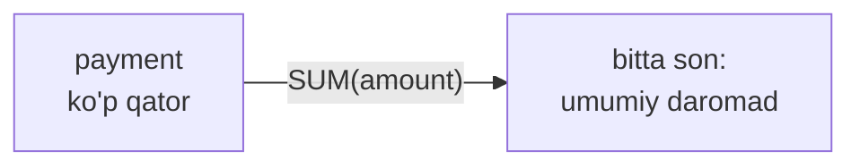
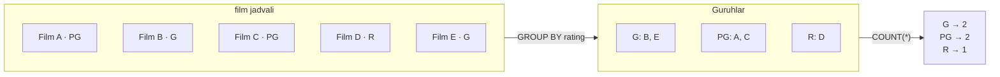
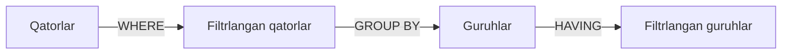

# 03 — Agregatsiya, GROUP BY va HAVING

> ⏱️ Vaqt: 4–5 soat · 📊 Daraja: boshlang'ich → o'rta · 🗃️ Baza: `dvdrental`

## 🎯 Bu darsdan keyin siz

- [ ] `COUNT`, `SUM`, `AVG`, `MIN`, `MAX` bilan ma'lumotni xulosalaysiz;
- [ ] "**har bir X uchun** nechta / qancha?" savollariga javob berasiz;
- [ ] `WHERE` va `HAVING` farqini aniq bilasiz;
- [ ] oylik hisobotlarni `DATE_TRUNC` + `GROUP BY` bilan qurasiz;
- [ ] bir so'rovda bir nechta shartli hisobni `FILTER` bilan qilasiz.

> [!NOTE]
> **Nega bu data engineer uchun muhim?** Warehouse'dagi har bir hisobot, dashboard va **mart** jadvali aslida `GROUP BY` natijasi. "Kunlik daromad", "har bir mijozning umumiy xaridi", "oylik faol foydalanuvchilar" — hammasi shu darsdan.


## 📖 Bu darsdagi atamalar

To'liq ro'yxat: [Atamalar lug'ati](../atamalar.md).

| Atama | Ma'nosi | Misol |
|---|---|---|
| **Agregatsiya** | Ko'p qatorni bitta songa jamlash | barcha to'lovlar → umumiy daromad |
| **Agregat funksiya** | Jamlovchi funksiya | `COUNT`, `SUM`, `AVG`, `MIN`, `MAX` |
| **`COUNT(*)`** | Barcha qatorlar soni | nechta to'lov bor |
| **`COUNT(ustun)`** | Shu ustuni bo'sh bo'lmagan qatorlar soni | nechta ijara qaytarilgan |
| **`COUNT(DISTINCT …)`** | Takrorlanmas qiymatlar soni | nechta turli mijoz to'lagan |
| **`GROUP BY`** | Qatorlarni guruhlarga ajratish | har reyting uchun alohida |
| **Guruh** | Bir xil qiymatli qatorlar to'plami | barcha `PG` filmlar |
| **`HAVING`** | Guruhlarni filtrlash (guruhlashdan keyin) | 150$ dan ko'p to'laganlar |
| **`FILTER`** | Agregatni faqat shartli qatorlar uchun hisoblash | `COUNT(*) FILTER (WHERE rating = 'G')` |
| **Pivot** | Qatorlarni ustunlarga aylantirish | reytinglar yonma-yon ustunlarda |
| **Hisobot** (report) | Biznes savollariga javob beruvchi jamlangan jadval | oylik daromad |
| **Data mart** | Warehouse'dagi bitta mavzu uchun tayyor jadvallar | "Sotuvlar" marti |
| **Dashboard** | Asosiy raqamlar va grafiklar bitta ekranda | rahbar har kuni ko'radigan panel |

### Bir rasmda: agregatsiya nima?

| | Agregatsiyasiz | Agregatsiya bilan |
|---|---|---|
| Savol | "Har bir to'lovni ko'rsat" | "Jami qancha to'langan?" |
| Natija | minglab qator | **bitta** qator |
| SQL | `SELECT amount FROM payment;` | `SELECT SUM(amount) FROM payment;` |

---

## 1. Agregat funksiyalar: ko'p qatorni bitta songa aylantirish 📦



| Funksiya | Nima qiladi | NULL'ni |
|---|---|---|
| `COUNT(*)` | qatorlar soni | **sanaydi** |
| `COUNT(ustun)` | `NULL` bo'lmagan qiymatlar soni | sanamaydi |
| `COUNT(DISTINCT ustun)` | unikal qiymatlar soni | sanamaydi |
| `SUM(ustun)` | yig'indi | e'tiborsiz qoldiradi |
| `AVG(ustun)` | o'rtacha | e'tiborsiz qoldiradi ⚠️ |
| `MIN` / `MAX` | eng kichik / katta | e'tiborsiz qoldiradi |

```sql
SELECT COUNT(*)                   AS tolovlar_soni,
       COUNT(DISTINCT customer_id) AS mijozlar_soni,
       SUM(amount)                AS umumiy_daromad,
       ROUND(AVG(amount), 2)      AS ortacha_tolov,
       MIN(payment_date)          AS birinchi_tolov,
       MAX(payment_date)          AS oxirgi_tolov
FROM payment;
```

### ⚠️ COUNT(*) va COUNT(ustun) farqi

```sql
SELECT COUNT(*)            AS jami_ijaralar,
       COUNT(return_date)  AS qaytarilganlar,
       COUNT(*) - COUNT(return_date) AS qaytarilmaganlar
FROM rental;
```

> [!CAUTION]
> `AVG` `NULL` larni **tashlab yuboradi**, nol deb hisoblamaydi. Masalan, 10 ta mijozdan 3 tasining bahosi `NULL` bo'lsa, `AVG` faqat 7 tasining o'rtachasini beradi. Agar `NULL` ni 0 deb hisoblash kerak bo'lsa: `AVG(COALESCE(baho, 0))`. Qaysi biri to'g'ri ekanini **biznes** hal qiladi, siz esa farqni bilishingiz shart.

---

## 2. GROUP BY: "har bir … uchun" 🗂️

`GROUP BY` qatorlarni guruhlarga ajratadi, agregat funksiya esa **har bir guruh uchun alohida** ishlaydi.



```sql
-- Har bir reytingda nechta film bor?
SELECT rating,
       COUNT(*)              AS filmlar_soni,
       ROUND(AVG(length), 1) AS ortacha_uzunlik
FROM film
GROUP BY rating
ORDER BY filmlar_soni DESC;
```

### Oltin qoida 🥇

> **`SELECT` dagi har bir ustun yo `GROUP BY` da bo'lishi, yo agregat funksiya ichida bo'lishi kerak.**

```sql
-- ❌ XATO: column "film.title" must appear in the GROUP BY clause...
SELECT rating, title, COUNT(*)
FROM film
GROUP BY rating;
```

Nega? `PG` guruhida o'nlab film bor. Baza qaysi `title` ni ko'rsatishni bilmaydi. Mantiqan ham savol noto'g'ri qo'yilgan.

### Bir nechta ustun bo'yicha guruhlash

```sql
-- Har bir (reyting, narx) juftligi bo'yicha
SELECT rating,
       rental_rate,
       COUNT(*) AS soni
FROM film
GROUP BY rating, rental_rate
ORDER BY rating, rental_rate;
```

### Ifoda bo'yicha guruhlash: oylik hisobot ⭐

2-darsdagi `DATE_TRUNC` endi o'z kuchini ko'rsatadi:

```sql
-- Oylik daromad
SELECT DATE_TRUNC('month', payment_date)::date AS oy,
       COUNT(*)                                AS tolovlar,
       SUM(amount)                             AS daromad
FROM payment
GROUP BY DATE_TRUNC('month', payment_date)
ORDER BY oy;
```

> [!TIP]
> PostgreSQL'da `GROUP BY 1` (birinchi ustun bo'yicha) deb ham yozish mumkin. Tez tahlilda qulay, lekin production kodda ustun nomini yozing: ustunlar tartibi o'zgarsa, `GROUP BY 1` jimgina noto'g'ri ishlaydi.

---

## 3. HAVING: guruhlarni filtrlash 🧹



| | `WHERE` | `HAVING` |
|---|---|---|
| Nimani filtrlaydi | **qatorlarni** | **guruhlarni** |
| Qachon ishlaydi | `GROUP BY` dan **oldin** | `GROUP BY` dan **keyin** |
| Agregat ishlatsa bo'ladimi | ❌ yo'q | ✅ ha |

```sql
-- 150$ dan ko'p to'lagan mijozlar
SELECT customer_id,
       COUNT(*)     AS tolovlar,
       SUM(amount)  AS jami
FROM payment
GROUP BY customer_id
HAVING SUM(amount) > 150
ORDER BY jami DESC;
```

```sql
-- WHERE va HAVING birga:
-- faqat 2007-yil aprel to'lovlari (WHERE), keyin 10 tadan ko'p to'lov qilgan mijozlar (HAVING)
SELECT customer_id,
       COUNT(*) AS tolovlar
FROM payment
WHERE payment_date >= '2007-04-01'
  AND payment_date <  '2007-05-01'
GROUP BY customer_id
HAVING COUNT(*) > 10
ORDER BY tolovlar DESC;
```

> [!IMPORTANT]
> Qatorga oid shartni doim `WHERE` ga yozing, `HAVING` ga emas. `WHERE` keraksiz qatorlarni guruhlashdan **oldin** tashlab yuboradi, shuning uchun so'rov ancha tez ishlaydi.

> [!TIP]
> Sana oralig'i uchun `>= boshi AND < keyingi_boshi` patternini ishlating, `BETWEEN` emas. `BETWEEN '2007-04-01' AND '2007-04-30'` 30-aprel kuni soat 00:00 dan keyingi to'lovlarni **yo'qotadi**. Bu data engineeringdagi eng keng tarqalgan xatolardan biri.

---

## 4. FILTER va shartli agregatsiya 🎛️

Bitta so'rovda bir nechta shartli hisob kerak bo'lsa:

```sql
SELECT COUNT(*)                                  AS jami,
       COUNT(*) FILTER (WHERE rating = 'G')      AS g_filmlar,
       COUNT(*) FILTER (WHERE rating = 'R')      AS r_filmlar,
       ROUND(AVG(length) FILTER (WHERE rating = 'PG-13'), 1) AS pg13_ortacha
FROM film;
```

`FILTER` PostgreSQL'da bor. Boshqa bazalarda (va eski kodlarda) xuddi shu natija `CASE` bilan olinadi. Ikkalasini ham tanib olishingiz kerak:

```sql
SELECT SUM(CASE WHEN rating = 'G' THEN 1 ELSE 0 END) AS g_filmlar,
       SUM(CASE WHEN rating = 'R' THEN 1 ELSE 0 END) AS r_filmlar
FROM film;
```

### Pivot: qatorlarni ustunlarga aylantirish

```sql
-- Har bir narx toifasida reytinglar bo'yicha filmlar soni
SELECT rental_rate,
       COUNT(*) FILTER (WHERE rating = 'G')     AS "G",
       COUNT(*) FILTER (WHERE rating = 'PG')    AS "PG",
       COUNT(*) FILTER (WHERE rating = 'PG-13') AS "PG-13",
       COUNT(*) FILTER (WHERE rating = 'R')     AS "R",
       COUNT(*) FILTER (WHERE rating = 'NC-17') AS "NC-17",
       COUNT(*)                                 AS jami
FROM film
GROUP BY rental_rate
ORDER BY rental_rate;
```

---

## 5. ROLLUP: oraliq va umumiy jami (bonus) ➕

```sql
SELECT rating,
       rental_rate,
       COUNT(*) AS soni
FROM film
GROUP BY ROLLUP (rating, rental_rate)
ORDER BY rating, rental_rate;
```

`ROLLUP` har bir `rating` uchun oraliq jamini va oxirida umumiy jamini qo'shadi (u qatorlarda guruh ustuni `NULL` bo'ladi). Excel'dagi "Subtotal" ga o'xshaydi.

---

## 6. Yangilangan bajarilish tartibi 🔄

1-darsdagi zanjirga ikkita yangi qadam qo'shildi:


Shundan kelib chiqadi:

- `WHERE` da agregat ishlatib bo'lmaydi: guruhlar hali yo'q.
- `HAVING` da `SELECT` dagi aliasni ishlatib bo'lmaydi (standart SQL'da): `SELECT` hali bajarilmagan. Shuning uchun `HAVING SUM(amount) > 150` deb ifodani qayta yozamiz.
- `ORDER BY` da alias ishlaydi.

---

## 🧠 Esda qolarli xulosa

| # | Qoida |
|:---:|---|
| 1 | `COUNT(*)` qatorlarni, `COUNT(ustun)` `NULL` bo'lmaganlarni sanaydi |
| 2 | `AVG` `NULL` ni tashlab yuboradi, nol deb hisoblamaydi |
| 3 | `SELECT` dagi ustun = `GROUP BY` da yoki agregat ichida |
| 4 | `WHERE` qatorlarni (oldin), `HAVING` guruhlarni (keyin) filtrlaydi |
| 5 | Sana oralig'i: `>= boshi AND < keyingi_boshi` |
| 6 | Shartli hisob: `COUNT(*) FILTER (WHERE …)` yoki `SUM(CASE …)` |
| 7 | Tartib: FROM → WHERE → **GROUP BY → HAVING** → SELECT → ORDER BY → LIMIT |

---

## ✍️ Endi navbat sizda

1. [`queries.sql`](queries.sql) dagi so'rovlarni ishga tushiring.
2. [`mashqlar.md`](mashqlar.md) dagi mashqlarni yeching.
3. Qo'shimcha: [SQLBolt](https://sqlbolt.com/) 10–12-darslar, [Mode: SQL Aggregate Functions](https://mode.com/sql-tutorial/sql-aggregate-functions/).

⬅️ [02 — Funksiyalar va CASE](../02-funksiyalar-case/README.md) · **Keyingi dars:** 04 — JOIN'lar (tez orada) 🔜
