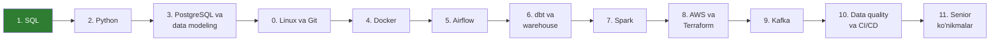

# 🛠️ Data Engineering: noldan Senior darajagacha

O'zbek tilida, chuqur va amaliy o'rganish yo'li. Har bir modulda darslar, ishlaydigan SQL/Python kodlar, mashqlar (yechimlari yashirin) va bitta portfolio loyihasi bor.

> [!NOTE]
> To'liq yo'l xaritasi, ya'ni har bosqichning maqsadi, resurslari va "tayyorsiz, agar…" checklistlari: **[ROADMAP.md](ROADMAP.md)**

## 🗺️ Yo'l xaritasi bir qarashda

## 📈 Progress

| # | Modul | Holat | Papka |
|---|---|---|---|
| 1 | SQL (chuqur) | 🟢 Jarayonda | [01-sql](01-sql/README.md) |
| 2 | Python | ⚪ Kutilmoqda | — |
| 3 | PostgreSQL va data modeling | ⚪ Kutilmoqda | — |
| 0 | Linux, terminal, Git | ⚪ Kutilmoqda (Docker'dan oldin) | — |
| 4 | Docker | ⚪ Kutilmoqda | — |
| 5 | ETL/ELT va Airflow | ⚪ Kutilmoqda | — |
| 6 | dbt va data warehouse | ⚪ Kutilmoqda | — |
| 7 | Apache Spark | ⚪ Kutilmoqda | — |
| 8 | AWS va Terraform | ⚪ Kutilmoqda | — |
| 9 | Kafka va streaming | ⚪ Kutilmoqda | — |
| 10 | Data quality, testing, CI/CD | ⚪ Kutilmoqda | — |
| 11 | Senior ko'nikmalar | ⚪ Kutilmoqda | — |

## 📚 Qanday o'qish kerak

1. **Darsni o'qing** (`README.md`) va har bir misolni o'zingiz bazada ishga tushiring. Faqat o'qish yetarli emas.
2. **`queries.sql`** faylidagi kodlarni o'zgartirib, nima bo'lishini kuzating.
3. **`mashqlar.md`** dagi masalalarni yeching. Yechimni ochishdan oldin kamida 15 daqiqa o'zingiz urinib ko'ring.
4. Har modul oxiridagi **loyihani** qilib, shu repozitoriyga joylang.

> [!TIP]
> **60/40 qoidasi:** vaqtingizning 60% qismi kod yozishga, 40% qismi o'qishga ketsin. Kursni tomosha qilish o'rganish emas.

## ⏱️ Haftalik rejim (12–15 soat)

| Kun | Vaqt | Nima qilish |
|---|---|---|
| Dushanba–Juma | Har kuni 1.5 soat | 30 daqiqa dars, 60 daqiqa kod |
| Shanba | 3–4 soat | Mashqlar va loyiha |
| Yakshanba | 1–2 soat | Takrorlash va haftalik xulosa |
